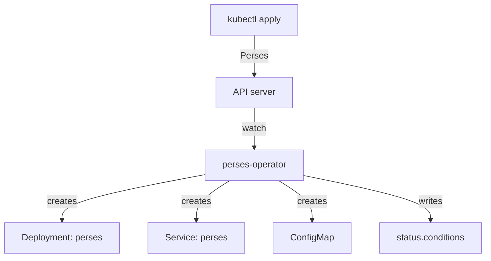

# What The Perses Operator Does

Before you change a `Perses` resource, you need to know which program reads it and what that program does with it. This part explains the controller behind the Perses Operator, the four custom resources it adds to the cluster, and how it was installed in your playground. With that picture, every later status message names a component you already know.

## A controller that runs a loop

The Perses Operator is a controller. A controller is a program that watches objects of some kinds through the Kubernetes API server and, for each change, runs a reconciliation: it compares the object you declared with what exists in the cluster and creates, updates or deletes objects until they match. It never waits for you to run a command. It reacts to every change of the objects it watches.

The objects the operator watches are custom resources. A custom resource definition (CRD) adds a new kind of object, such as `Perses`, to the Kubernetes API, with a schema that says which fields it accepts. The operator adds four kinds, all in the API group `perses.dev` at version `v1alpha2`:

| Kind | Scope | What the operator does with it |
| --- | --- | --- |
| `Perses` | Namespace | Creates and updates one Perses server: a Deployment or StatefulSet, a Service and a ConfigMap |
| `PersesDatasource` | Namespace | Copies the datasource into the Perses project named after its namespace |
| `PersesGlobalDatasource` | Cluster | Copies the datasource into every selected server as a global datasource |
| `PersesDashboard` | Namespace | Copies the dashboard into the Perses project named after its namespace |

Two of those kinds produce Kubernetes objects, and the other three produce objects inside a Perses server, through the Perses REST API. The flow for one `Perses` resource looks like this:



The diagram shows one reconciliation: the operator reads the `Perses` resource from the API server, creates the server's objects, and writes the result back into the resource's status.

## Look at the operator in your playground

The operator itself is a Deployment in the namespace `perses-operator`. Look at it and at the CRDs it brought:

<!-- astrona:playground:renew -->

```sh
kubectl -n perses-operator get deployments,pods
kubectl get crds | grep perses.dev
```

The first command shows one Deployment and one pod for the controller. The pod has two containers: the manager, which runs the reconciliation, and `kube-rbac-proxy`, which protects the metrics endpoint. The second command lists the four CRDs from the table above, each ending in `.perses.dev`.

The API server now knows the new kinds, so `kubectl` can describe their fields. Ask it for the top-level fields of the `Perses` resource:

```sh
kubectl api-resources --api-group=perses.dev
kubectl explain perses.spec --api-version=perses.dev/v1alpha2
```

`kubectl api-resources` lists the four kinds with their short names and scope; `PersesGlobalDatasource` is the only one that is not namespaced. `kubectl explain` prints the fields under `spec`, such as `image`, `config`, `storage`, `service` and `resources`. The schema comes from the CRD, so it is the most exact field list you have.

## How the operator was installed

The playground installed the operator with its Helm chart, `perses-operator` version 0.5.0, which runs the operator image `persesdev/perses-operator:v0.5.0`. Read the values the playground set:

```sh
helm -n perses-operator list
helm -n perses-operator get values perses-operator
```

The release is named `perses-operator`, and two values were changed from the defaults: `certManager.enable=false` and `testFramework.enabled=false`. The first one matters. By default the chart expects cert-manager, a separate controller that issues TLS certificates, and uses it for the operator's webhook server. With `certManager.enable=false`, the chart generates a self-signed certificate itself instead. The cost is that the conversion webhooks between the old `v1alpha1` and the current `v1alpha2` versions are off, so only `v1alpha2` objects can be used. Every object in this course is `v1alpha2`.

The chart also keeps the CRDs when you uninstall it (`crd.keep: true`), because deleting a CRD deletes every object of that kind. Removing the operator therefore never removes your dashboards from the cluster by accident.

You now know which program reads a `Perses` resource, which four kinds it watches, and how it was installed. What you do not know yet is what the operator builds from one `Perses` resource and how it talks to the server it built.

## Common pitfalls

> [!WARNING]
> - **Applying `v1alpha1` objects without cert-manager.** The conversion webhooks are off when the chart runs with `certManager.enable=false`, so use `perses.dev/v1alpha2` for every object.
> - **Changing the objects the operator created.** A hand edit to the Deployment or the Service is replaced on the next reconciliation. Change the `Perses` resource instead.
> - **Looking for the operator in the namespace of the server.** The controller runs in `perses-operator`; the server it created runs in the namespace of the `Perses` resource.
