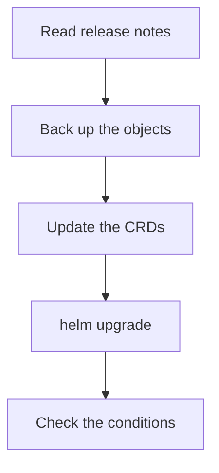

# Install And Upgrade The Operator

The operator is software that runs in your cluster, so it has a life cycle of its own: it is installed, configured, upgraded and sometimes removed. A mistake at this level affects every Perses server the operator manages. This part reads the Helm release that installed the operator in your playground, explains the chart settings that matter, and describes the order of an upgrade.

## Read the release

Helm is a package manager for Kubernetes. A chart is a package of Kubernetes manifests with settings, and a release is one installation of a chart with a name and a revision number. The playground installed the chart `perses/perses-operator` as the release `perses-operator` in the namespace `perses-operator`. List the releases there:

<!-- astrona:playground:renew -->

```sh
helm list -n perses-operator
```

The listing shows the release name, its revision, its status, the chart name and version, and the application version. Print the settings you gave the chart, not all its defaults:

```sh
helm get values perses-operator -n perses-operator
```

The output holds the two values the playground set, `certManager.enable: false` and `testFramework.enabled: false`. Everything else comes from the defaults of the chart. To see every setting with its default value, ask the chart itself:

```sh
helm show values perses/perses-operator --version 0.5.0
```

The release also keeps a history. Each `helm upgrade` adds a revision, and `helm history perses-operator -n perses-operator` lists them, which is what you read before a rollback.

## The settings that matter

The chart has settings for the operator image, its resources, its service account and its webhooks. The one setting that changes how you work is `certManager.enable`. The operator has an admission webhook, an HTTPS endpoint that the Kubernetes API server calls to validate or convert objects before it stores them. The API server only calls a webhook over TLS, so the webhook needs a certificate.

With `certManager.enable=true`, the chart asks cert-manager, a certificate controller, to issue and renew that certificate, and the CRDs can then convert between API versions. With `certManager.enable=false`, which the playground uses, the chart generates a certificate itself, and the CRDs are limited to the `v1alpha2` version. A cluster that stores objects in `v1alpha1` needs cert-manager so the conversion webhook can work. Check which versions the CRDs serve:

```sh
kubectl get crd perses.perses.dev -o jsonpath='{range .spec.versions[*]}{.name}{" served="}{.served}{" storage="}{.storage}{"\n"}{end}'
```

Each line is a version of the API with two flags: `served` says the API server answers requests in that version, and `storage` marks the one version in which objects are written to etcd. There is exactly one storage version.

## Where the CRDs live

The custom resource definitions (CRDs) are cluster-wide objects, and they carry the schema of every field. How a Helm chart ships them decides what an upgrade does. Helm installs the files of a chart's `crds` folder on the first installation and never updates or deletes them afterwards. A CRD placed in the chart's `templates` is a normal part of the release and is upgraded with it. Find out where this chart keeps them:

```sh
helm show crds perses/perses-operator --version 0.5.0 | head -5
```

If the command prints CRD manifests, they are in the `crds` folder and an upgrade does not change them: apply the new CRD files with `kubectl apply --server-side` before `helm upgrade`. If it prints nothing, the CRDs are in the templates and the release upgrades them. Read this before every upgrade, because a new operator that runs against an old CRD ignores the fields the CRD does not know.

## The order of an upgrade

An upgrade has a safe order. First read the release notes of the new version for changed fields and removed API versions. Second, back up the objects, because the operator and its CRDs are the only things that read them:

```sh
kubectl get perses,persesdashboards,persesdatasources,persesglobaldatasources -A -o yaml > perses-objects-backup.yaml
```

Third, update the CRDs if the chart does not. Fourth, upgrade the release and keep your values:

```sh
helm upgrade perses-operator perses/perses-operator --version 0.5.0 \
  --namespace perses-operator --reuse-values --dry-run
```

The `--dry-run` flag renders the upgrade without changing the cluster. Use it first, remove it to run the upgrade, and set the target version in place of `0.5.0`. Finally, check that the operator is available and that the managed objects are still `Available`:

```sh
kubectl -n perses-operator get deployments
kubectl get perses,persesdashboards,persesdatasources -A
```

An operator upgrade does not restart the Perses servers by itself. It reconciles each `Perses` resource with the new code, so a new operator version can change a Deployment, for example by adding a field. Watch the rollouts of the servers after the upgrade, not only the operator pod.



The diagram shows the order of an upgrade: read, back up, update the schema, upgrade the release and verify.

You can now read a Helm release, explain what `certManager.enable` changes and upgrade the operator in a safe order. The module has one question left: what you do when the cause of a failure is the operator itself and not a server.

## Common pitfalls

> [!WARNING]
> - **Upgrading the chart and expecting new CRD fields.** If the CRDs are in the chart's `crds` folder, Helm leaves them as they are.
> - **Using `--reuse-values` after a chart change that renames values.** Render with `--dry-run` first and read the result.
> - **Switching `certManager.enable` on a live cluster without a plan.** The webhook certificate changes, and so do the API versions the CRDs can convert.
> - **Upgrading without a backup of the objects.** A bad schema change can reject objects that were valid before.
