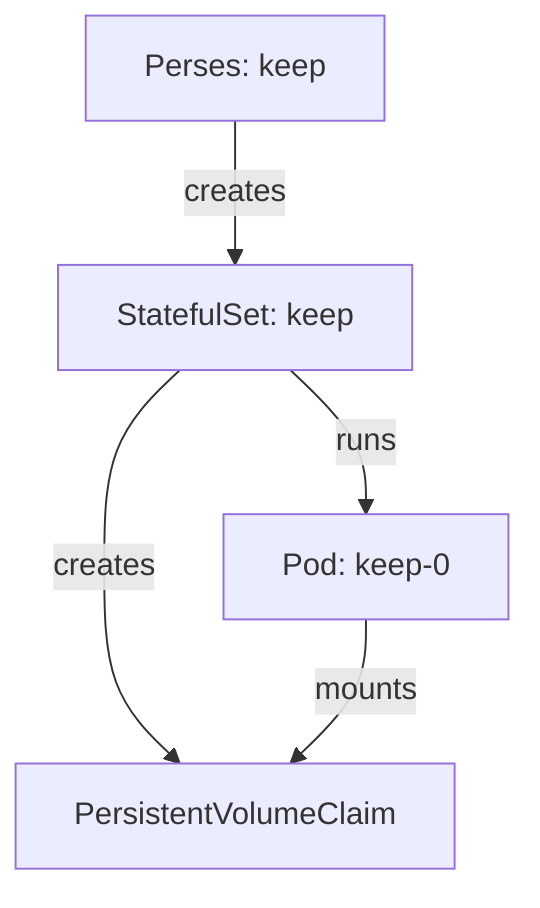

# Persistent Storage And Workload Kinds

A Perses server with a file database writes every project, dashboard and datasource to a folder in the pod. If that folder lives in the pod, the data lives and dies with the pod. This part moves the folder onto a PersistentVolumeClaim, shows which workload the operator creates for it, and proves with a real restart that the data stays.

## Why emptyDir loses data

The server in your playground uses `storage.emptyDir`. An `emptyDir` is a folder that Kubernetes creates when a pod starts on a node and deletes when the pod is removed from that node. A restart of the container keeps it, but the deletion of the pod does not. The operator turns this setting into a Deployment, because a Deployment pod has no stable identity and needs no stable disk.

The operator also treats the two kinds of storage differently on purpose. Any storage other than `emptyDir` gives a StatefulSet. A StatefulSet is a workload for pods that keep their name and their disk: the pod is always called `<name>-0`, and it always gets the same PersistentVolumeClaim back. A file database is exactly that kind of data, so the StatefulSet is the right workload for it.

## Declare a server with a PersistentVolumeClaim

Use a second server so the playground server stays as it is. The server below lives in its own namespace `keep` and asks for a one gibibyte claim. The `pvcTemplate` field takes the same fields as the spec of a PersistentVolumeClaim: the access modes and the requested size, and optionally a `storageClassName`. Without a class name the cluster's default StorageClass is used.

<!-- astrona:playground:renew -->

Save this as `namespace-keep.yaml`:

```yaml
apiVersion: v1
kind: Namespace
metadata:
  name: keep
```

Apply it:

```sh
kubectl apply -f namespace-keep.yaml
```

Save this as `perses-keep.yaml`:

```yaml
apiVersion: perses.dev/v1alpha2
kind: Perses
metadata:
  name: keep
  namespace: keep
  labels:
    app.kubernetes.io/instance: keep
spec:
  image: docker.io/persesdev/perses:v0.54.0
  containerPort: 8080
  config:
    database:
      file:
        folder: /perses
        extension: yaml
  storage:
    pvcTemplate:
      accessModes:
        - ReadWriteOnce
      resources:
        requests:
          storage: 1Gi
```

Apply it:

```sh
kubectl apply -f perses-keep.yaml
```

Then check the result:

```sh
kubectl -n keep get perses,statefulsets,deployments,pvc
```

The operator created a StatefulSet named `keep`, no Deployment, and one PersistentVolumeClaim. The claim name is built from the volume name in the StatefulSet and the pod name, so it ends with `keep-0`. Wait until the pod is ready:

```sh
kubectl -n keep rollout status statefulset/keep
```

## Find where the volume is mounted

The operator decides the mount path, not you, so read it from the StatefulSet instead of guessing. The next command prints the volume mounts of the Perses container:

```sh
kubectl -n keep get statefulset keep -o jsonpath='{.spec.template.spec.containers[0].volumeMounts}{"\n"}'
```

One mount is the claim, and its path is the folder of the database. If that path were different from `config.database.file.folder`, the server would write into the pod's own file system and the claim would stay empty. That is the first thing to check when data does not survive a restart even though a claim exists.

## Prove that the data survives

Create a project through the Perses API. A project is the folder in Perses that holds dashboards and datasources, and the operator creates one for each namespace it serves. The request goes from the `tester` pod to the Service `keep`, which the operator named after the resource:

```sh
kubectl -n observability exec deploy/tester -- curl -s -X POST \
  -H 'Content-Type: application/json' \
  -d '{"kind":"Project","metadata":{"name":"kept"},"spec":{}}' \
  http://keep.keep:8080/api/v1/projects
```

Now delete the pod. The StatefulSet creates it again under the same name and attaches the same claim:

```sh
kubectl -n keep delete pod keep-0
kubectl -n keep rollout status statefulset/keep
```

Ask for the project again:

```sh
kubectl -n observability exec deploy/tester -- sh -c \
  'curl -s http://keep.keep:8080/api/v1/projects | jq -r ".[].metadata.name"'
```

The list contains `kept`. Run the same two steps against the `emptyDir` server in the namespace `perses`, and the project you create there is gone after the pod is deleted. The only difference between the two servers is the `storage` field.



The diagram shows that the claim belongs to the StatefulSet, not to the pod, which is why a new pod finds the old data.

## What a claim does not protect

A PersistentVolumeClaim keeps the data across pod deletions. It does not keep the data when the claim itself is deleted, and deleting the `Perses` resource can remove it. Deleting a StatefulSet does not delete its claims by default, but whether the claim survives the deletion of the whole resource depends on the retention policy of the StatefulSet and the reclaim policy of the volume. Before you delete a server with data, read both. A claim is also not a backup: a damaged database file is damaged on the disk too.

You can now choose the storage of a server, name the workload each choice produces, and prove persistence with a pod deletion. The open question is what else in the pod specification you can set from the resource, and that starts with the configuration file the server reads.

## Common pitfalls

> [!WARNING]
> - **Judging persistence from the claim alone.** A bound claim proves a disk exists. Create a project, delete the pod and read the project again.
> - **Changing the storage of a server that already holds data.** The data stays on the old volume or the old `emptyDir`. Plan a copy of the data before you switch.
> - **Expecting a Deployment with a claim.** The operator creates a StatefulSet for every storage setting except `emptyDir`.
> - **Asking for a size the cluster cannot give.** A claim that stays `Pending` keeps the pod `Pending`. Read `kubectl describe pvc` for the reason.

## Your mission: Make Perses Data Survive A Restart

You can now declare a server with a PersistentVolumeClaim and prove that its data survives the deletion of its pod. The graded lab starts with a namespace `archive` and asks you to run a Perses server there that keeps a project across a restart.

The lab runs in its own cluster, so first pause your playground. Nothing in it is lost:

```sh
astrona stop ats-111-playground-010-02
```

Then start the lab:

```sh
astrona run --git ssh://git@github.com/astrona-io/ATS111.git -c sections/section-010/module-02/labs/lab-01
```

The task is on the next page. Solve it on your own first. When you think you are done, send it for grading:

```sh
astrona submit -c sections/section-010/module-02/labs/lab-01
```

When the lab is done, remove it and start your playground again:

```sh
astrona destroy ats-111-lab-010-02
astrona start ats-111-playground-010-02
```
