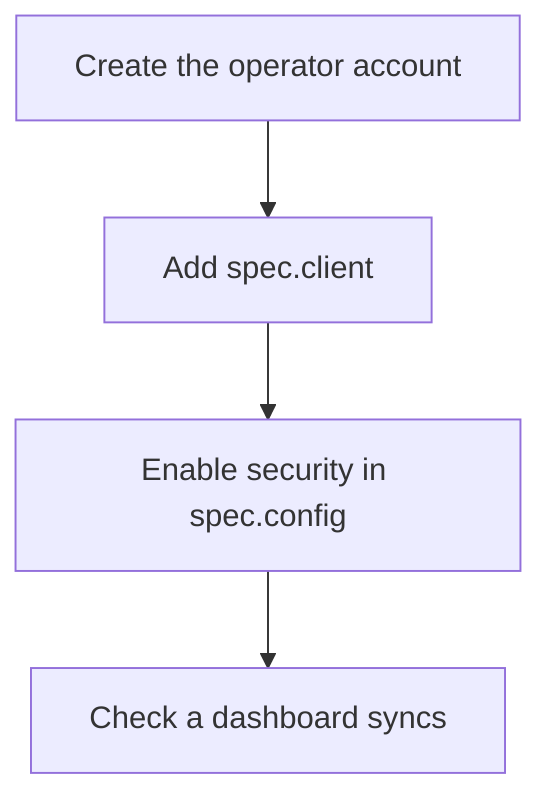

# TLS, Provisioning And The Operator Client

Three fields of the `Perses` resource decide how the server is trusted. `tls` encrypts the connection to the server. `provisioning` loads resources from files at start. `client` tells the operator how to log in to the server when the server requires authentication. This part says what each one does, where its details are found in the cluster, and in which order the pieces must be set up so the operator does not lock itself out.

## Look at the fields first

The three fields are objects, and their exact members belong to the installed operator version. Print their schemas from the cluster:

<!-- astrona:playground:renew -->

```sh
kubectl explain perses.spec.tls --api-version=perses.dev/v1alpha2
kubectl explain perses.spec.client --api-version=perses.dev/v1alpha2
kubectl explain perses.spec.provisioning --api-version=perses.dev/v1alpha2
```

Read each description before you write a value. The sections below explain what the fields are for, so the schema reads as a list of choices and not as a puzzle.

## TLS between clients and the server

Transport Layer Security (TLS) encrypts the HTTP traffic and lets a client check the server's identity with a certificate. In the `Perses` resource, `spec.tls` points to certificates that are stored in Kubernetes Secrets or ConfigMaps. The operator mounts them into the pod and writes the matching paths into the server configuration. When the server serves TLS, the address the operator uses changes from `http` to `https`, and every client of the server, including the `tester` pod in this module, must use `https` and trust the certificate authority (CA).

The certificate must be valid for the name clients use, which is the Service name inside the cluster. A certificate for `perses.example.com` does not work for `perses.perses.svc.cluster.local`. Create certificates with the tool your cluster uses, such as cert-manager, and keep their renewal in the same process. A certificate that expires without renewal makes the server unreachable for the operator and for dashboards at the same time.

## Provisioning

Provisioning means that the server reads resource files from folders at start and keeps them in sync on an interval. The configuration section `provisioning` lists the folders. The resource field `spec.provisioning` is the operator's way to feed those folders from Secrets or ConfigMaps, so a file in a Kubernetes object ends up in a folder in the pod. Provisioned resources are controlled by the files: a change in the user interface to a provisioned resource does not last.

Use provisioning for resources that must exist before any custom resource is reconciled, such as a global datasource that the operator's own objects depend on. Use `PersesDashboard` and `PersesDatasource` objects for everything a team owns, because those are visible in Kubernetes with status conditions and provisioned files are not.

## The operator client

The operator changes the server through its REST API. When the server runs with authentication on, every request needs credentials, so the operator needs them too. The field `spec.client` tells it how to authenticate. It supports basic authentication with a user name and a password from a Secret, OAuth with client credentials, client certificates for mutual TLS, and Kubernetes authentication, in which the operator presents its service account token to a server configured to accept it. It also holds the TLS settings the operator uses to verify the server's certificate.

The order matters. If you turn on authentication in `spec.config.security` first and add `spec.client` second, there is a time in which the operator is refused by its own server. Dashboards then show the condition reason `PersesConnectionFailed`, and the `Perses` resource itself can still say `Available`. Do it in the reverse order: create the account the operator will use, add `spec.client`, and only then enable authentication. Test with a dashboard after each step.



The diagram shows a safe order: the operator can authenticate before the server demands it.

## Check what the operator can reach

Whatever you set, the final test is the same: can the operator still change the server? Create a small `PersesDashboard` in a team namespace, read its conditions, and ask the Perses API for the dashboard. If `PersesConnectionFailed` appears, check in this order: the scheme and port of the address (`http` or `https`), the certificate name, the credentials in the Secret, and the operator log in the container `manager`.

You can now say what `tls`, `provisioning` and `client` do, find their fields with `kubectl explain`, and set them in an order that does not cut the operator off. You have reached the end of the server configuration.

## Common pitfalls

> [!WARNING]
> - **Turning on authentication before `spec.client` is set.** The operator is refused by its own server, and dashboards fail with `PersesConnectionFailed`.
> - **A certificate for the wrong name.** Clients verify the name they connect to, which is the Service name in the cluster.
> - **Letting a certificate expire.** Plan renewal with the certificate, not after the outage.
> - **Editing a provisioned resource in the user interface.** The file wins at the next sync.
