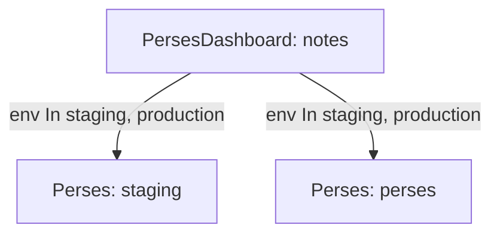

# Several Servers And Selectors

One Perses server for everything is the simplest setup, and it stops being enough as soon as a team wants to try a dashboard before production sees it. The operator supports more than one server in a cluster, and the field that decides where an object goes is `instanceSelector`. This part runs a second server, labels both, and sends a dashboard to one server and then to both.

## How the operator picks servers

A `PersesDashboard`, a `PersesDatasource` and a `PersesGlobalDatasource` each have `spec.instanceSelector`. It is a Kubernetes label selector, the same type a Deployment uses for its pods, but it selects `Perses` resources instead of pods. The operator lists all `Perses` resources in the cluster, keeps those whose own `metadata.labels` match, and sends the object to each one that is available. A server in another namespace is a valid target, because the selector is not limited to the namespace of the dashboard.

Two forms of selector exist. `matchLabels` is a map in which every pair must match. `matchExpressions` is a list of rules with an operator (`In`, `NotIn`, `Exists`, `DoesNotExist`), and every rule must match. Both forms can be used together, and then both must be true. With no selector at all, every `Perses` resource matches.

## Run a second server

The playground has the server `perses`, which stands for production here. Add a label that says so, so the selector has something to use:

<!-- astrona:playground:renew -->

```sh
kubectl -n perses label perses perses env=production
```

Now the staging server. It lives in its own namespace so its Service name `staging` does not collide with anything. Save this as `namespace-perses-staging.yaml`:

```yaml
apiVersion: v1
kind: Namespace
metadata:
  name: perses-staging
```

Apply it:

```sh
kubectl apply -f namespace-perses-staging.yaml
```

Save this as `perses-staging.yaml`:

```yaml
apiVersion: perses.dev/v1alpha2
kind: Perses
metadata:
  name: staging
  namespace: perses-staging
  labels:
    app.kubernetes.io/instance: staging
    env: staging
spec:
  image: docker.io/persesdev/perses:v0.54.0
  containerPort: 8080
  config:
    database:
      file:
        folder: /perses
        extension: yaml
  storage:
    emptyDir: {}
  resources:
    requests:
      memory: 128Mi
    limits:
      memory: 512Mi
```

Apply it:

```sh
kubectl apply -f perses-staging.yaml
```

Then check the result:

```sh
kubectl -n perses-staging rollout status deployment/staging
kubectl get perses -A --show-labels
```

Both `Perses` resources are listed with their labels. The staging server answers at `http://staging.perses-staging:8080`, because the operator names the Service after the resource.

## Send a dashboard to staging only

The dashboard below has a single text panel, so it needs no datasource. Its selector asks for `env: staging`, so only the staging server may receive it. Save this as `persesdashboard-payments-notes.yaml`:

```yaml
apiVersion: perses.dev/v1alpha2
kind: PersesDashboard
metadata:
  name: notes
  namespace: payments
spec:
  instanceSelector:
    matchLabels:
      env: staging
  config:
    display:
      name: Release Notes
    duration: 1h
    panels:
      notes:
        kind: Panel
        spec:
          display:
            name: Notes
          plugin:
            kind: Markdown
            spec:
              text: "Notes for the next release."
    layouts:
      - kind: Grid
        spec:
          display:
            title: Notes
          items:
            - x: 0
              y: 0
              width: 12
              height: 4
              content:
                $ref: "#/spec/panels/notes"
```

Apply it:

```sh
kubectl apply -f persesdashboard-payments-notes.yaml
```

Then ask both servers for the dashboard:

```sh
kubectl -n observability exec deploy/tester -- curl -s -o /dev/null -w 'staging: %{http_code}\n' \
  http://staging.perses-staging:8080/api/v1/projects/payments/dashboards/notes
kubectl -n observability exec deploy/tester -- curl -s -o /dev/null -w 'production: %{http_code}\n' \
  http://perses.perses:8080/api/v1/projects/payments/dashboards/notes
```

Staging answers `200` and production answers `404`. The operator created the project `payments` on the staging server only, because the dashboard did not select production.

## Send it to both servers

When the team is happy, the dashboard must also reach production. Change the selector to a `matchExpressions` rule that accepts both values of the label `env`:

```sh
kubectl -n payments patch persesdashboard notes --type merge -p '{"spec":{"instanceSelector":{"matchLabels":null,"matchExpressions":[{"key":"env","operator":"In","values":["staging","production"]}]}}}'
```

The patch removes `matchLabels` with `null` and sets the rule. Ask the two servers again with the same two requests as before. Production now answers `200` too, because the operator re-evaluates the selector at every reconciliation and the production server now matches.



The diagram shows one object delivered to two servers by one selector.

## What a change of selector does not do

When you narrow a selector again, the copy on the server that no longer matches is not removed by the selection itself. Check each server after you narrow a selector, and delete the leftover copy through the API or with `percli delete` if it must go. This is why a selector change that moves a dashboard from one server to another is a two-step change.

You can now run two servers, label them, and route objects with `matchLabels` and `matchExpressions`. The open question is what a datasource lets a dashboard do once it has reached a server.

## Common pitfalls

> [!WARNING]
> - **Labelling the pods and not the resource.** Selectors read `metadata.labels` of the `Perses` resource, not `spec.metadata.labels`.
> - **Using no selector for a staging dashboard.** An object without `instanceSelector` goes to every server, including production.
> - **Narrowing a selector and trusting the old server to forget.** Check the server that no longer matches.
> - **Creating the second server in the namespace of the first with the same name.** The workload and the Service names come from the resource name and must be unique in the namespace.
